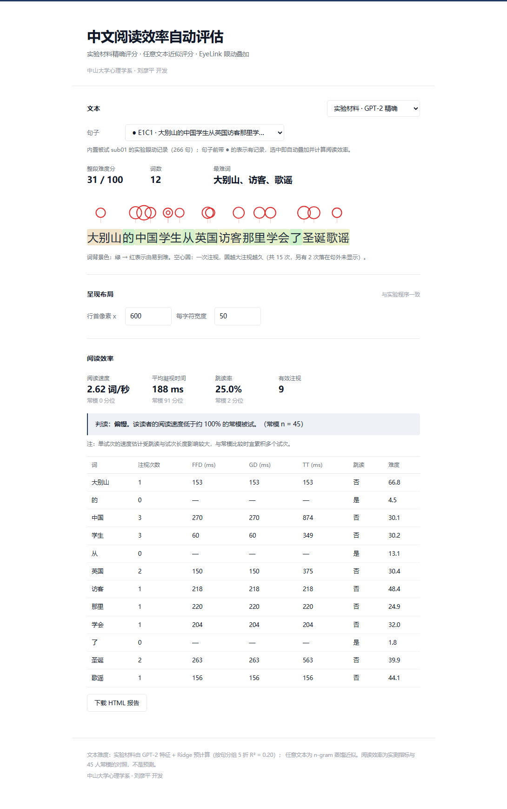
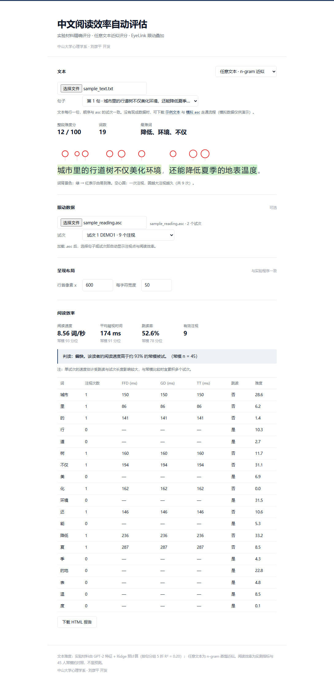
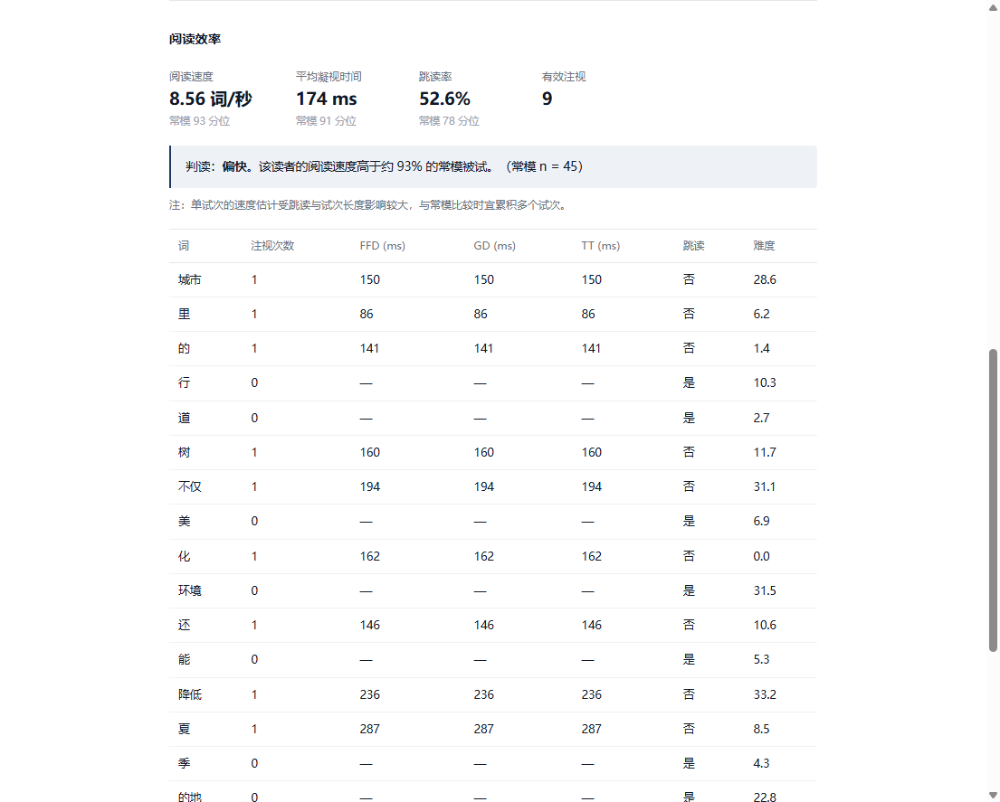

# 中文阅读效率自动评估 · 技术文档

> 中山大学心理学系 · 刘彦平
>
> 在线地址：https://youngping.github.io/reading-efficiency-demo/
>
> 代码仓库：https://github.com/Youngping/reading-efficiency-demo

---

## 1 项目概述

这是一个**纯静态**的中文阅读评估网页工具：不需要服务器、不需要数据库、不调用任何外部模型服务。打开网页即可对文本做逐词难度评分，并可在提供 EyeLink 眼动记录时，把注视点叠加到句子上、计算读者的阅读效率。

它解决两个不同层面的问题：

| 层面 | 回答的问题 | 依赖 |
|---|---|---|
| 文本难度 | 这段话对一般读者有多难？哪些词最难？ | 只需要文本 |
| 读者效率 | 这位读者读得快还是慢？在人群中处于什么位置？ | 需要眼动记录 |

两者刻意分开呈现：难度是**模型预测**，阅读效率是**实测指标 + 常模对照**，不是预测。

---

## 2 功能清单

- **实验材料模式**：内置 296 句实验材料（4 种条件，共 1181 条）的逐词难度；内置一名被试 266 句的真实眼动记录，选中句子即自动叠加注视点并计算效率。
- **任意文本模式**：上传 `.txt`（每行一句）与 `.asc` 眼动文件，按试次序号对应，自动完成分词、难度评分、注视映射。
- **DataViewer 风格眼动叠加**：每个注视一个空心圆，圆越大注视越久，绘制在文字上方，不遮挡文本。
- **阅读效率评估**：阅读速度、平均凝视时间、跳读率，与 45 人常模做百分位对照并给出判读。
- **报告导出**：一键下载自包含的 HTML 报告。
- **单文件离线版**：一个 1.4 MB 的 HTML，双击即可运行。

---

## 3 系统架构

```
┌──────────────────────────── 浏览器（全部计算在此完成） ────────────────────────────┐
│                                                                                    │
│  index.html ── style.css                                                           │
│      │                                                                             │
│      └── app.js                                                                    │
│            ├── 数据加载：window.__DATA__（离线版）或 fetch data/*.json（在线版）      │
│            ├── 文本层：材料查表 / n-gram 蒸馏查表 + Ridge 打分                        │
│            ├── 眼动层：asc 解析 → 试次切分 → 注视映射 → FFD/GD/TT/跳读                │
│            └── 展示层：热力图 + SVG 注视圆点 + 常模百分位                             │
│                                                                                    │
└────────────────────────────────────────────────────────────────────────────────────┘
                                      │
                                      ▼
                          data/*.json（全部为预计算结果）
```

没有任何后端进程，因此也不存在服务端数据留存：上传的文件只在本机浏览器的内存中被读取。

### 3.1 数据文件

| 文件 | 体积 | 内容 |
|---|---|---|
| `materials.json` | 1038 KB | 1181 条实验材料的词边界、逐词难度、surprisal、entropy |
| `material_gaze.json` | 58 KB | 一名被试（编号 sub01）266 句的注视坐标与时长 |
| `ngram.json` | 216 KB | 字级 trigram/bigram/unigram 的 surprisal 查表 |
| `scoring.json` | 0.2 KB | Ridge 的标准化参数与系数 |
| `vocab.json` | 55 KB | 4521 词的分词词典 |
| `norm.json` | 0.9 KB | 45 名被试的阅读速度、凝视时间、跳读率 |
| `sample_text.txt` / `sample_reading.asc` | 1.3 KB | 演示用文本与模拟眼动（MOCK） |

---

## 4 开发原理

### 4.1 文本难度模型

**训练数据**：54 名被试阅读 296 句中文材料的眼动数据。对每个词，取所有被试非跳读的凝视时间（GD ∈ [60, 1500] ms）求平均，作为该词的"人群难度"，要求至少 10 名被试读过。最终得到 5,071 个词。

**标签**：`log(跨被试平均 GD)`，均值 5.596，标准差 0.184。

**特征**（3 维）：

| 特征 | 说明 |
|---|---|
| `t_surprisal` | GPT-2（uer/gpt2-chinese-cluecorpussmall）按字计算 surprisal，词内求和 |
| `t_entropy` | 同上，词内取平均 |
| `length` | 词的字数 |

**模型**：标准化 + Ridge 回归。正则强度在训练折内部用 3 折交叉验证从 {0.1, 1, 10, 100} 中选择。

**验证**：`GroupKFold(5)`，按**句子**分组，保证同一句的词不同时出现在训练与测试折，避免同句上下文造成乐观偏差。

**结果**：

| 指标 | 值 |
|---|---|
| R² | **0.197** |
| Pearson r | 0.444 |
| Spearman ρ | 0.415 |
| MAE（log 空间） | 0.130 |

标准化系数：surprisal **+0.053**、词长 **+0.044**、entropy **−0.004**。方向符合预期：越意外、越长的词加工越久；entropy 在联合模型中贡献接近零。

**分数映射**：把预测的 log(GD) 按训练集折外预测的 1% / 99% 分位线性映射到 0–100，超出部分截断。因此"难度分"是**相对分数**，不是毫秒。

### 4.2 n-gram 蒸馏（任意文本模式）

浏览器无法运行 GPT-2，因此把 GPT-2 的输出蒸馏成查表模型。

**训练**：从实验材料、问卷文本中收集 1,547 句、41,604 字的中文语料，用 GPT-2 逐字计算真实 surprisal，然后统计：

- trigram（前 2 字 + 本字）：6,766 条
- bigram（前 1 字 + 本字）：5,599 条
- unigram（本字）：1,417 条

每一条都是该上下文下 surprisal 的均值。

**推理**：给定新文本，逐字按 `trigram → bigram → unigram → 默认值 8.0` 回退查表，词内求和得到词级 surprisal，再送入 4.1 的 Ridge 模型打分。

**精度**：留出 310 句检验，与 GPT-2 真值相比 Pearson **r = 0.921**、MAE **0.535**。

**代价**：数值不等于 GPT-2 原值；语料外的新词会回退到单字级；词级 entropy 用训练均值 4.17 代替（该特征系数接近零，影响可忽略）。

### 4.3 眼动解析与词映射

**asc 解析**：逐行匹配 `EFIX`（注视）、`ESACC`（扫视）、`MSG`（事件）。试次边界由 `Sent MYKEYWORD 100/200` 标记切分，句子标识来自 `SENTENCEID`。

**词映射**：假设刺激按固定布局呈现——

```
字符 i 的像素区间 = [600 + i×50, 600 + (i+1)×50)
```

注视点的 x 坐标落入哪个词的区间，就记为该词的一次注视。这两个参数可在页面"呈现布局"中修改。

**指标定义**：

| 指标 | 定义 |
|---|---|
| FFD | 首次通过该词的第一个注视时长 |
| GD | 首次通过该词的所有连续注视时长之和 |
| TT | 该词上所有注视（含回看）时长之和 |
| 跳读率 | 无任何注视的词占比 |
| 阅读速度 | 词数 ÷（该试次末次注视结束 − 首次注视开始） |

**注视圆点**：SVG 绘制，半径按时长映射

```js
r = 4 + 13 * sqrt(clamp((duration - 60) / 440, 0, 1))
```

圆点在文字上方（cy=40），底部与文字顶部留 15–20 px，不遮挡阅读。超出句子范围的注视会被过滤，图例中会注明"另有 N 次落在句外未显示"。

### 4.4 常模与百分位

常模来自 45 名被试（54 名眼动被试中同时具备 EEG 数据的子集）。每名被试贡献三个句子级中位数：阅读速度（词/秒）、平均凝视时间、跳读率。

百分位定义为"常模中严格小于当前值的比例"。由于 n = 45，**百分位的最小分辨率约为 2.2 个百分点**，因此"93 分位"应理解为"45 人中排第 3–4 位"，而非精确排名。

### 4.5 前端实现要点

- **单一刷新流程**：没有"分析"按钮。任何选择（模式、句子、试次、布局参数）都触发 `refresh()`，重新计算并渲染。
- **字符定位**：用 `Range` API 逐字符测量 DOM 中的实际位置，把眼动坐标映射到页面坐标，因此不受字体、字号影响。
- **绘制时机**：先同步绘制一次，再在 `requestAnimationFrame` 中重绘，兼顾首帧可见与布局稳定。
- **状态隔离**：材料模式与任意文本模式各自维护句子来源与眼动来源，切换时不会互相污染。

---

## 5 使用指南

### 5.1 实验材料模式（无需上传）

打开页面即进入该模式。系统内置一名被试的眼动记录，默认选中第一个有记录的句子（下拉框中带 **●** 标记）。



操作要点：

1. **句子下拉框**：共 1181 条，带 ● 的 266 条有内置眼动。选择任意句子立即更新。
2. **难度区**：显示整段难度分、词数、最难词，句子按词着色（绿→红表示由易到难）。
3. **注视圆点**：红色空心圆，圆越大注视越久。悬停可看具体毫秒数。
4. **选择无 ● 的句子**：只显示文本难度，并提示"该句没有内置眼动记录"。

### 5.2 任意文本模式

切换到"任意文本 · n-gram 近似"后，先上传文本，再上传眼动。


操作顺序：

1. **上传 `.txt`**：每行一句，顺序与 asc 的试次一致。没有现成文件时，可点"示例文本"与"模拟 asc"下载演示数据。
2. **上传 `.asc`**：仅接受 EyeLink ASCII 格式；`.edf` 需先用 EyeLink 工具转换。未上传 `.txt` 时该控件禁用。
3. **选择句子**：出现句子下拉框后，选中即出结果；句子与试次按序号自动联动。



### 5.3 结果解读



- **阅读速度（词/秒）**：词数除以该试次的阅读时间。常模中位数约 6.19。
- **平均凝视时间（ms）**：非跳读词的 GD 均值。常模中位数约 130 ms。
- **跳读率**：没有被注视的词占比。常模中位数约 45%。
- **判读**：按速度百分位分为偏慢（<30）、中等（30–70）、偏快（>70）。
- **逐词表**：每个词的注视次数、FFD、GD、TT、是否跳读、难度分。

注意：单试次的速度估计受跳读和句子长度影响较大，与常模比较时宜累积多个试次。

### 5.4 导出报告

滚动到页面底部，点"下载 HTML 报告"，得到一份自包含的报告，包含文本、难度分、阅读效率与逐词表。

---

## 6 部署

### 6.1 GitHub Pages

1. 仓库 Settings → Pages
2. Source 选 `Deploy from a branch`
3. 分支 `main`，目录 `/docs`
4. 保存后等待约 30 秒

### 6.2 单文件离线版

```powershell
python build_standalone.py
```

生成 `reading_efficiency_standalone.html`（约 1.4 MB），双击即可运行，不依赖服务器与网络。

### 6.3 重新生成数据

```powershell
python build_static.py        # 材料难度（需 GPT-2 模型缓存）
python build_material_gaze.py # 内置眼动（需 test_data/sub*.asc）
python build_ngram.py         # n-gram 蒸馏
python build_standalone.py    # 单文件离线版
```

---

## 7 局限与注意事项

1. **文本难度模型只见过 296 句实验材料**。跨文体、跨领域的外推存在误差，R² = 0.197 是句内泛化成绩，不是跨语料成绩。
2. **句首词的 surprisal 恒为 0**（GPT-2 没有前文），因此句首词难度系统性偏低。
3. **任意文本为近似值**。n-gram 蒸馏与原版 GPT-2 的相关系数为 0.92，不能等同。
4. **分词口径**。任意文本使用基于实验材料词表的最大匹配分词，未登录词按单字处理，可能与语言学分词不同。
5. **布局假设**。词映射依赖"600 + i×50"的固定布局；其他呈现程序需修改参数，否则整体错位。
6. **常模样本小**。45 人，百分位分辨率约 2.2%，且不能外推到其他年龄段或语言。
7. **内置眼动只有一名被试**。266 句有记录，其余句子仅显示文本难度。
8. **数据合规**。`material_gaze.json` 与 `norm.json` 来自人类被试，公开发布前需确认伦理审批与知情同意范围。

---

## 8 文件结构

```
reading_demo/
├── docs/                     # GitHub Pages 发布目录
│   ├── index.html
│   ├── app.js
│   ├── style.css
│   ├── .nojekyll
│   └── data/                 # 预计算数据（见 3.1）
├── assets/images/            # 文档截图
├── models/                   # 文本难度模型（复现用）
├── build_static.py           # 生成材料与常模
├── build_material_gaze.py    # 生成内置眼动
├── build_ngram.py            # 蒸馏 n-gram
├── build_standalone.py       # 打包单文件离线版
├── make_demo_data.py         # 生成示例文本与模拟 asc
├── train_text_difficulty.py  # 训练文本难度模型
├── app.py / asc_io.py / layout.py / difficulty.py / reader.py
└── requirements.txt
```

---

## 9 引用

若在研究中引用本工具，请注明：

> 刘彦平. 中文阅读效率自动评估（2026）. 中山大学心理学系.
> https://github.com/Youngping/reading-efficiency-demo
